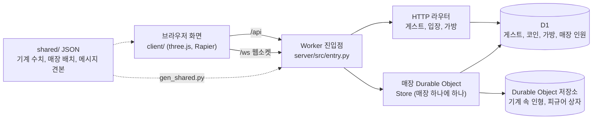

# toycrane

링크 하나로 들어와 로그인 없이 다른 사람들과 한 매장을 걸어 다니며 인형뽑기를 하는 웹 3D 게임입니다.

운영 중입니다. 배포 주소는 https://toycrane.toycrane.workers.dev 입니다(2026-11-17 응답 확인, 마지막 변경 2026-11-03).

직접 만든 인형뽑기방 게임입니다. 기존 캐릭터나 상표는 쓰지 않고, 인형과 기계는 모두 새로 만들었습니다.

## 한눈에 보기

| 항목 | 내용 |
| --- | --- |
| 기간 | 2026-10-30 ~ 2026-11-03 (main 커밋 286개) |
| 인원과 역할 | 1인 개발. 무엇을 만들지와 배포 여부는 본인이 정하고, 코드는 Claude Code가 작성했습니다 |
| 상태 | 운영 중 (Cloudflare 무료 요금제) |
| 주요 기술 | Cloudflare Workers(Python), Durable Objects, D1, TypeScript, three.js, Rapier 물리 엔진 |

## 주요 기능

- 닉네임만 정하면 바로 매장에 들어갑니다. 매장 하나에 50명까지 들어가고, 차면 다음 매장으로 안내합니다.
- 같은 매장에 있는 사람들이 캐릭터로 걸어 다니는 모습이 실시간으로 보이고, 남이 뽑는 판을 옆에서 구경할 수 있습니다.
- 기계는 네 종류입니다. 집게로 인형을 집는 기계, 두 막대 위 상자를 떨어뜨리는 피규어 기계, 고리 걸기, 미는 뽑기가 있습니다.
- 집게가 인형을 실제로 쥐고 들고 놓습니다. 결과는 미리 정해진 확률이 아니라 물리 계산으로 나오고, 판이 끝난 뒤 기계 안 모양이 다음 판으로 이어집니다.
- 코인은 교환소에서 무료로 받습니다. 다른 사람에게 코인을 조르거나 나눠 줄 수 있습니다. 돈을 받는 기능은 없습니다.
- 뽑은 인형은 가방에 모이고, 매장 지도와 배경음이 있습니다. 휴대폰에서는 화면 조이스틱으로 움직입니다.

## 구조



화면과 서버는 Worker 하나로 배포됩니다. 화면 파일(`client/dist`)은 정적 자산으로 나가고, `/api`와 `/ws`로 오는 요청만 파이썬 서버가 받습니다.
매장 하나는 Durable Object 하나가 맡아 그 안의 사람들 움직임과 뽑기 판을 서로에게 전달합니다. 게스트, 코인, 가방은 D1 데이터베이스에 저장합니다.
기계 수치와 매장 배치는 `shared/`의 JSON 하나를 화면과 서버가 같이 읽어서 두 쪽 값이 어긋나지 않게 합니다.
서버 코드는 헥사고날 구조(`adapter` → `app` → `domain`)로 나뉘어 있고, 이 방향은 아래 검증의 계층 검사가 지킵니다.

## AI와 함께 만든 방식

- 커밋 286개 모두에 Claude 공동 작성자 표시가 있습니다(`git log --grep='Co-Authored-By: Claude'` 286개 / 전체 286개). 코드는 Claude Code가 쓰고, 본인은 설계 승인, 플레이 피드백, 배포 허락을 맡았습니다.
- 저장소에 `CLAUDE.md`나 `AGENTS.md`는 없습니다. 대신 기능마다 설계 문서와 구현 계획을 먼저 쓰고, 에이전트가 그 문서를 따라 작업했습니다.
  - 설계 문서 10개(`docs/superpowers/specs/`), 구현 계획 12개(`docs/superpowers/plans/`), 작업 장부 3개(`docs/superpowers/records/`)가 있습니다.
  - 흐름은 설계 → 계획 → 구현 → 테스트 → 최종 리뷰 → 배포 허락 → 배포 뒤 확인 → 기록입니다. 계획 문서마다 작업 단위로 테스트 명령이 적혀 있고, 작업 장부에는 작업마다 돌린 테스트와 결과가 남아 있습니다.
- 설계 문서는 누가 정했는지를 표시합니다. `[결정]`은 사용자가 정한 것, `[내 판단]`은 Claude가 정한 것, `[빌더]`는 만드는 쪽이 정할 것입니다. 설계 문서 10개에 `[결정]` 표시가 64곳 있습니다(범례 줄 제외).
- 사람이 정한 큰 방향의 예입니다. 현금 결제를 붙이지 않고 코인은 무료로 줍니다. 무료 한도를 넘으면 유료로 바꾸지 않고 만석으로 기다리게 합니다. 서버 확률 대신 실제 물리로 뽑게 바꿨습니다(`docs/superpowers/specs/2026-10-31-toycrane-physics-crane-design.md`).
- 계획 문서에는 배포 전에 사용자 허락을 받는 단계가 들어 있습니다. 배포와 확인 기록 52항목 중 27항목에 사용자 피드백이나 요청이 적혀 있습니다(`docs/DEPLOY_LOG.md`).

## 검증

| 무엇을 | 어떻게 | 규모 |
| --- | --- | --- |
| 서버 규칙 | `cd server && uv run pytest` | 테스트 파일 43개, 2026-11-17 실행 시 321개 통과 |
| 서버 계층 | `cd server && PYTHONPATH=src uv run lint-imports`, `tests/test_architecture.py` | 계약 2개(계층 방향, `app`·`domain`이 Workers 런타임을 모름) |
| 화면 로직 | `cd client && npx vitest run src` | 테스트 파일 88개(`client/src`), 2026-11-17 실행 시 모두 통과 |
| 뽑기 난이도 | `cd client && SIM_TRIALS=1000 npm run sim` | 시뮬레이션 파일 8개, 기계마다 여러 판을 돌려 확률을 맞춤 |
| 실제 화면 | `node client/e2e/<이름>.mjs` (헤드리스 크롬) | 스크립트 17개(한 판, 구경, 기기 사이 결과 일치, 휴대폰, 성능 측정 포함) |
| 배포 주소 | `node server/scripts/smoke.mjs <주소> <경우...>` | 경우 13개(입장, 두 창, 코인, 판, 환불 등) |

CI는 없습니다. 테스트는 작업마다 로컬에서 돌렸고, 그 결과는 작업 장부와 `docs/DEPLOY_LOG.md`에 남아 있습니다.
`npm --prefix client test`는 느린 시뮬레이션(`client/sim/`)까지 기본 제한 시간 5초로 함께 돌려서 그 부분이 실패합니다. 화면 로직만 볼 때는 `npx vitest run src`를, 시뮬레이션은 `npm run sim`을 씁니다(작업 장부도 같은 명령을 씁니다).

리뷰와 테스트로 잡은 AI 실수 예시입니다.

- `50e44a9` 코인 주기와 조르기가 데이터베이스 응답을 기다리는 사이 바뀐 상태를 옛 사본으로 덮어쓰던 문제를 고쳤습니다.
- `817a508` 상자가 앞판을 넘어 기계 밖으로 떨어져도 당첨으로 치던 판정을 고쳤습니다.
- `a5f435b` 물리 뽑기 최종 리뷰에서 나온 문제 11개(번호가 겹치는 보고와 읽을 수 없는 보고를 받던 것, 접속이 끊긴 판의 환불 처리 등)를 고쳤습니다. 커밋 설명에 따르면 수정마다 실패하는 테스트를 먼저 썼습니다.

알려진 한계입니다. 뽑기 결과는 브라우저의 물리 계산이 정하고, 서버는 보고된 결과가 상식에 맞는지만 확인합니다(번호가 기계와 맞는지, 한 판 당첨 수가 한도 안인지, 자리가 기계 안인지. `server/src/toycrane/domain/report.py`). 조작된 브라우저를 완전히 막지는 못합니다.

## 시작하기

필요한 것: [uv](https://docs.astral.sh/uv/)(파이썬 3.14), Node.js, Cloudflare 계정(배포할 때만).

```bash
cd server && uv sync && cd ..                 # 서버 개발 의존성
npm --prefix client install                   # 화면 의존성

npm --prefix client run build                 # 화면 빌드(client/dist)
cd server && npx wrangler d1 migrations apply toycrane --local   # 처음 한 번
cd server && uv run pywrangler dev            # http://localhost:8787
```

테스트:

```bash
cd server && uv run pytest
cd server && PYTHONPATH=src uv run lint-imports
cd client && npx vitest run src               # 화면 로직
cd client && npm run sim                       # 난이도 시뮬레이션(느림)
```

휴대폰 점검, 화면 캡처, 공용 데이터 다시 만들기, 배포 명령은 [docs/DEVELOPMENT.md](docs/DEVELOPMENT.md)에 있습니다.

## 폴더 구조

| 폴더 | 내용 |
| --- | --- |
| `server/` | Python Workers 서버. `src/toycrane`(adapter, app, domain), `tests/`, `migrations/`(D1 표), `scripts/`(스모크, 공용 데이터 생성) |
| `client/` | TypeScript와 three.js 화면. `src/`(게임, 물리, 화면 부품), `sim/`(난이도 시뮬레이션), `e2e/`(헤드리스 크롬 점검) |
| `shared/` | 화면과 서버가 같이 읽는 JSON(기계 수치, 매장 배치, 메시지 견본) |
| `docs/` | 설계, 계획, 작업 장부, 배포 기록, 시제품 HTML(`docs/reference/prototypes/`) |
| `spikes/` | 파이썬 Durable Object 웹소켓 절전 동작 시험 코드 |

## 문서

- [배포와 확인 기록](docs/DEPLOY_LOG.md): 단계별 배포, 측정값, 라이브 확인 결과. 새 배포 기록은 이 파일에 덧붙입니다.
- [개발과 배포 명령](docs/DEVELOPMENT.md)
- [처음 설계](docs/superpowers/specs/2026-10-30-toycrane-design.md)
- [물리 뽑기 설계](docs/superpowers/specs/2026-10-31-toycrane-physics-crane-design.md)
- [설계 문서 목록](docs/superpowers/specs/), [구현 계획 목록](docs/superpowers/plans/), [작업 장부](docs/superpowers/records/)
